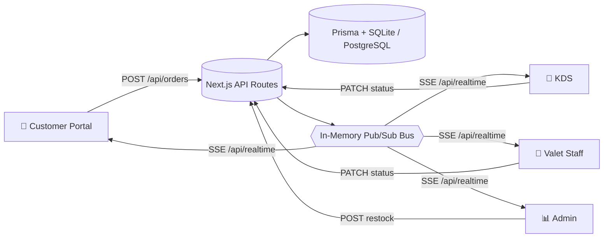

# DhabaOS: Real-Time Restaurant Management System for Indian Dhabas 🍛🚗

[](https://dhaba-qav3.onrender.com/)
[](https://nextjs.org/)
[](https://www.typescriptlang.org/)
[](https://www.prisma.io/)
[](https://tailwindcss.com/)
[](#-real-time-architecture)

**DhabaOS** is a full-stack Restaurant Management System (RMS) built for high-volume highway and urban dhabas. It connects **guests, kitchen staff, valet attendants, and branch managers** on one synchronized, real-time platform: QR table ordering, a live Kitchen Display System, valet car retrieval, and AI-powered footfall and inventory forecasting.

> **One app. Four roles. Zero chaos.**

---

## 🌐 Live Deployment

- 🖥️ **Live App:** [https://dhaba-qav3.onrender.com](https://dhaba-qav3.onrender.com/)
- 📦 **GitHub Repository:** [Debjit-prime/Dhaba](https://github.com/Debjit-prime/Dhaba)

> ⏳ **Heads up:** On Render's free tier the service sleeps after 15 minutes of inactivity. The first request after idle takes about 30 to 50 seconds to wake up and re-seed the demo database.

### 🔗 Jump Straight Into a Portal

| Portal | Route | Try It Live |
|---|---|---|
| 🔀 **Portal Switcher** | `/` | [Open](https://dhaba-qav3.onrender.com/) |
| 📱 **Customer Menu & Ordering** | `/menu?table=12` | [Open](https://dhaba-qav3.onrender.com/menu?table=12) |
| 🥘 **Kitchen Display System (KDS)** | `/kds` | [Open](https://dhaba-qav3.onrender.com/kds) |
| 🚗 **Valet Queue & Retrieval** | `/valet` | [Open](https://dhaba-qav3.onrender.com/valet) |
| 📊 **Admin Forecasting & Inventory** | `/admin` | [Open](https://dhaba-qav3.onrender.com/admin#inventory) |

> 💡 **Best way to see the real-time magic:** open the **Customer** and **KDS** portals in two tabs, place an order, and watch it appear in the kitchen instantly.

---

## 🌟 Core System Features

1. **📱 QR / Table-Scoped Customer Ordering**: Pick any of 20 tables, browse a visual menu, and check out from a slide-up cart drawer with simulated payments.
2. **🥘 Live Kitchen Display System**: A Kanban board that merges Dine-in, Swiggy, and Zomato tickets, with second-by-second urgency timers.
3. **🚗 Valet Retrieval System**: One-tap "Retrieve My Car" from the table, a live ETA tracker, and a priority-sorted staff queue.
4. **📊 AI Footfall Forecasting**: Moving-average and day-of-week seasonality models compare predicted vs. actual footfall.
5. **📦 Live Inventory Depletion Tracking**: Ingredient capacity bars with predictive stock-out alerts and one-click restock transfers.
6. **⚡ Real-Time Sync Across Portals**: Server-Sent Events keep every screen in lockstep, with no polling and no manual refresh.
7. **🌗 Light / Dark Mode**: A liquid-glass toggle in the floating pill header crossfades between sunlit and evening dining-room backdrops.

---

## 🧩 Portal Walkthroughs

Click a section to expand it.

<details>
<summary><b>🔀 Portal Switcher (<code>/</code>)</b></summary>

- Central role-selection hub with frosted glass cards and a character-blur entrance headline.
- Liquid-glass **Light / Dark Mode** toggle in the floating pill header.
- Crossfades between sunlit and evening dining-room backdrops, with top and bottom edge-blur overlays.

</details>

<details>
<summary><b>📱 Customer Menu & Ordering (<code>/menu?table=12</code> or <code>/customer</code>)</b></summary>

- **Table Selector (Tables 1 to 20):** header dropdown synced with the `?table=` URL parameter, carrying table context into orders and valet requests.
- **5 Curated Menu Categories:** Starters, Mains, Tandoor (Tandoori Chicken, Achari Paneer Tikka, Chicken Malai Tikka, Tandoori Stuffed Mushroom), Breads, and Beverages, each with Veg / Non-Veg badges and quantity steppers.
- **Checkout & Live Tracking:** slide-up cart drawer with cooking notes, **5% GST** calculation, simulated payment (UPI / GPay, Card, Cash on Table), live kitchen ticket status, and one-tap **Retrieve My Car** valet integration.

</details>

<details>
<summary><b>🥘 Kitchen Display System (<code>/kds</code> or <code>/kitchen</code>)</b></summary>

- **Translucent Kanban Board:** frosted glass *Pending → Preparing → Ready* columns that let the ambient backdrop show through in Light Mode and shift to smoked glass in Dark Mode.
- **Multi-Source Order Feed:** Dine-in, Swiggy, and Zomato tickets in one place, with **+ Swiggy** and **+ Zomato** buttons to simulate incoming orders.
- **Live Urgency Timers & Checklists:** real-time elapsed timers and interactive dish-level checkboxes.

| Elapsed Time | Badge |
|---|---|
| 🟢 `< 10 min` | New |
| 🟡 `10 to 20 min` | Warning |
| 🔴 `> 20 min` | Pulsing Late alert |

</details>

<details>
<summary><b>🚗 Valet System (<code>/valet</code>)</b></summary>

- **Customer View:** ticket card with a pulsing **Retrieve My Car** trigger, live ETA progress bar, and an animated vehicle track.
- **Staff View:** priority-ordered queue (`HIGH`, `MEDIUM`, `LOW`) with status filters, **Accept & In Transit** and **Mark Delivered** actions, and a **New Ticket** modal. Synced across tabs over SSE.

</details>

<details>
<summary><b>📊 Admin Forecasting & Inventory (<code>/admin</code> or <code>/dashboard</code>)</b></summary>

- **Footfall Analytics:** Today / 7 Days / 30 Days views with KPI cards (Predicted Footfall, Active Orders, Low Stock Items, Today's Revenue) and a **Predicted vs. Actual Footfall** chart.
- **Inventory & Restocking (`#inventory`):** real-time ingredient capacity bars, urgent depletion alerts, and an interactive **Request Stock Transfer** modal.

</details>

---

## 💻 Architecture & Tech Stack

| Layer | Technology | Role / Benefit |
|---|---|---|
| **Framework** | Next.js 14.2 (App Router) + React 18 + TypeScript | Full-stack rendering, routing, and API routes |
| **Styling & Theme** | Tailwind CSS + CSS custom properties | Responsive UI with light / dark persistence via `localStorage` |
| **Typography & Icons** | Inter Tight (`next/font/google`), lucide-react, Material Symbols Outlined | Clean type and consistent iconography |
| **Database & ORM** | Prisma with SQLite (default) or PostgreSQL | Zero-setup locally, production-ready when scaled |
| **Real-Time Engine** | Server-Sent Events (`/api/realtime`) + in-memory pub/sub bus | Instant multi-portal synchronization |
| **Deployment** | Render (Node runtime) | One-service full-stack hosting |

### ⚡ Real-Time Architecture



Every portal subscribes once through the `useRealtimeSubscription` hook. When any role changes data, the API writes to the database and broadcasts an event on the bus, and all connected screens update with no refresh.

---

## 🧠 Forecasting Engine

The forecasting logic lives in [`src/lib/forecasting.ts`](./src/lib/forecasting.ts).

- **7-day moving average** to smooth day-to-day noise in footfall.
- **Day-of-week seasonality** so a busy Saturday is not compared against a quiet Tuesday.
- **Predicted vs. actual** footfall, surfaced in the Admin dashboard.
- **Depletion estimates** that warn when a base ingredient is about to run out.

---

## 🗂️ Project Structure

<details>
<summary><b>Click to expand the file tree</b></summary>

```text
├── prisma/
│   ├── schema.prisma              # SQLite Prisma schema
│   ├── schema.postgresql.prisma   # Optional PostgreSQL schema
│   └── seed.ts                    # Menu, Tandoor, 20 tables, KDS, valet, inventory & footfall seed
├── public/assets/aistudio/        # Light & dark ambient background imagery
├── src/
│   ├── app/
│   │   ├── page.tsx               # Portal Switcher (/)
│   │   ├── (customer)/menu/       # Customer Ordering (/menu)
│   │   ├── (kitchen)/kds/         # Kitchen Display System (/kds)
│   │   ├── (valet)/valet/         # Valet System (/valet)
│   │   ├── (admin)/admin/         # Admin Dashboard (/admin)
│   │   └── api/                   # REST & SSE endpoints (/api/*)
│   ├── components/shared/         # ThemeProvider, ThemeToggle, SiteBackground, Nav & RoleSwitcherModal
│   ├── hooks/useRealtime.ts       # Client SSE subscription hook
│   └── lib/                       # Prisma client, realtime bus, forecasting engine, shared types
├── next.config.mjs                # Isolated .next-dev (dev) and .next (prod) build directories
├── start.sh                       # Cross-platform one-click local launcher
└── start-dhabaos.command          # macOS Finder one-click launcher
```

</details>

---

## 🔌 API Endpoints

| Method | Endpoint | Purpose |
|---|---|---|
| `GET` | `/api/menu` | Fetch ordered categories and available menu items |
| `GET` / `POST` | `/api/orders` | List or create dine-in / delivery orders |
| `PATCH` | `/api/orders/[id]/status` | Transition order: `PENDING → PREPARING → READY → COMPLETED` |
| `PATCH` | `/api/orders/[id]/items/[itemId]` | Toggle individual dish preparation status |
| `POST` | `/api/mock/ingest` | Simulate incoming Swiggy / Zomato delivery orders |
| `GET` / `POST` | `/api/valet` | Fetch valet queue or create / request vehicle retrieval |
| `PATCH` | `/api/valet/[id]/status` | Transition ticket: `REQUESTED → IN_PROGRESS → DELIVERED` |
| `GET` / `POST` | `/api/inventory` | View ingredient stock levels and record restock batches |
| `GET` | `/api/analytics/forecast` | Historical footfall, revenue, and AI demand predictions |
| `GET` | `/api/realtime` | Server-Sent Events stream for live multi-portal sync |

---

## 🚀 Running Locally

### Prerequisites
- Node.js (v18 or v20+ LTS)

### ⚡ Option 1: One-Click Launcher (Recommended)

```bash
# Linux / macOS / Windows (Git Bash)
bash start.sh
```

On macOS you can also double-click **`start-dhabaos.command`** in Finder.

<details>
<summary><b>What does <code>start.sh</code> do?</b></summary>

1. Checks Node.js.
2. Installs missing packages.
3. Creates `.env` if needed.
4. Generates the Prisma client for your OS.
5. Syncs the SQLite schema.
6. Seeds sample data if the database is empty (Menu, Tandoor, 20 Tables, KDS orders, Valet queue, Inventory, and 14 days of Footfall records).
7. Opens `http://localhost:3000` and starts the server.

</details>

### 🛠️ Option 2: Manual Setup

```bash
# 1. Install dependencies
npm install

# 2. Create local environment file
cp .env.example .env

# 3. Generate Prisma Client, push schema, and seed demo data
npm run db:generate
npm run db:push
npm run db:seed

# 4. Start development server
npm run dev
```

Open **http://localhost:3000** in your browser.

---

## ☁️ Deployment on Render

<details>
<summary><b>Render configuration</b></summary>

| Setting | Value |
|---|---|
| **Runtime** | Node |
| **Branch** | `main` |
| **Build Command** | `npm install --include=dev && npm run db:generate && npm run build` |
| **Start Command** | `npx prisma db push && npm run db:seed && npm run start` |

**Environment Variables**

```env
DATABASE_URL=file:./dev.db
NEXT_PUBLIC_APP_URL=https://dhaba-qav3.onrender.com
```

</details>

---

## ⚠️ Demo Notes

- 💳 **Payments are simulated.** UPI / GPay, Card, and Cash on Table do not process real transactions.
- 🛵 **Swiggy and Zomato orders are simulated** through the **+ Swiggy** / **+ Zomato** buttons and `/api/mock/ingest`.
- 🧪 The database is **seeded with demo data** on startup.

---

## 🤖 Development Disclosure

This platform was built with AI-assisted rapid engineering workflows, using **Google Antigravity** for implementation, while the product concept, domain flows, and design direction were defined by the author.

---

## 👤 Author

**Debjit** · [GitHub: @Debjit-prime](https://github.com/Debjit-prime)

⭐ If you found this project useful, consider giving the repo a star.
